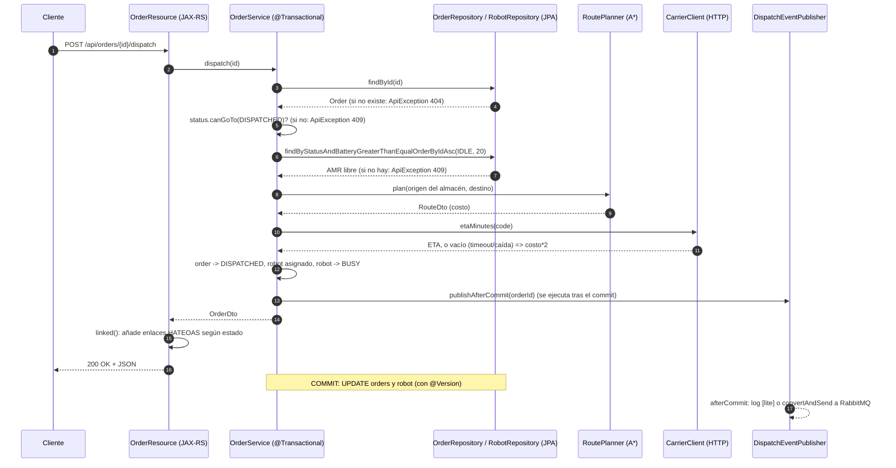
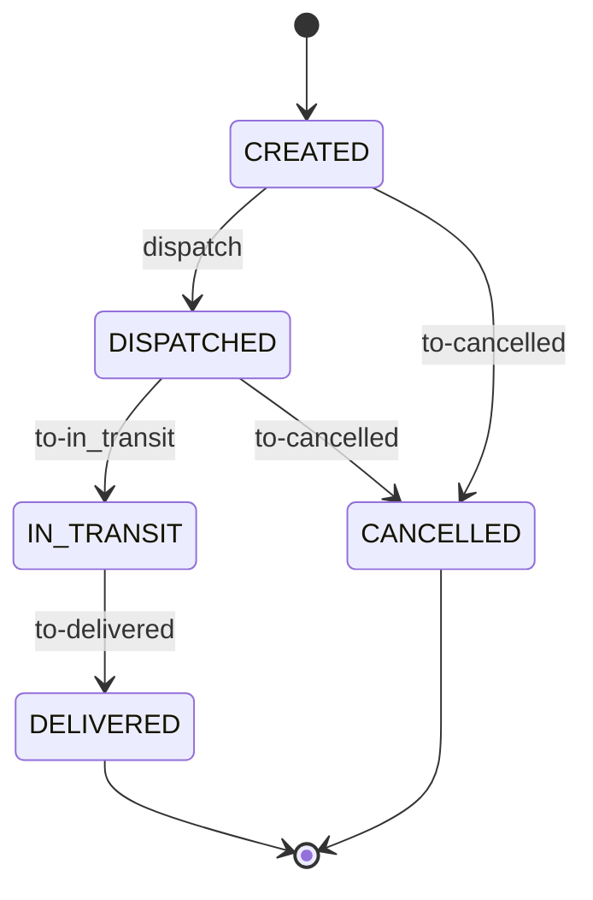
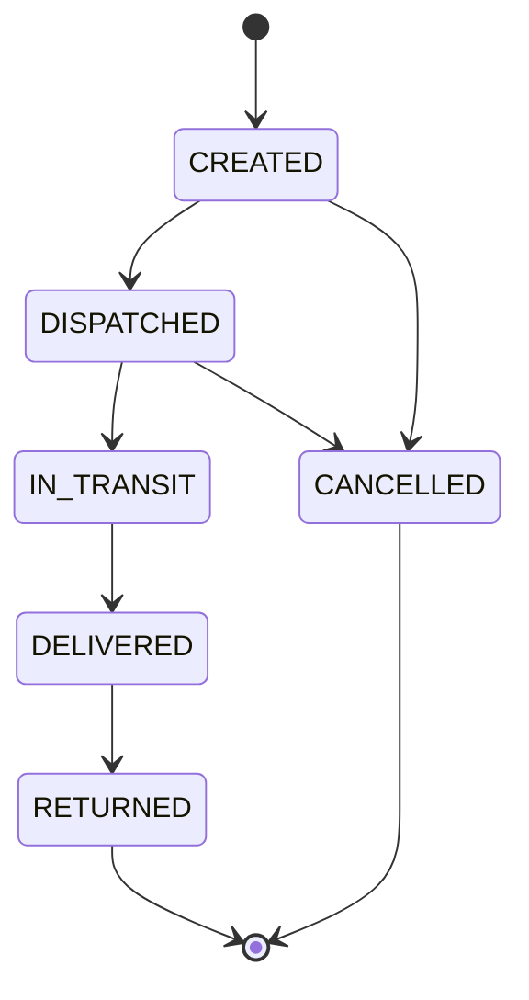

# INFORME — Laboratorio LOGISTPULSE

Modo de ejecución: **Modo A** (`./mvnw spring-boot:run`, H2 en memoria, puerto 8080, sin Redis/RabbitMQ). Java 21, Maven Wrapper.

## Parte 0 · Recorrido

### Qué se hizo
- Lectura de `OrderResource`, `OrderService`, `OrderStatus` y de `JerseyConfig`.
- Ejecución de `scripts/smoke.sh` con la aplicación levantada y de `./mvnw -q test`.

### Flujo de `POST /api/orders/{id}/dispatch`



### Cómo se probó
- `./mvnw -q test`: sin errores. Informes de surefire: `OrderStatusTest` 4 tests, `AStarPathfinderTest` 6 tests, 0 fallos.
- `bash scripts/smoke.sh` (app arriba): pasos 1–7 `ok` (200, 422, 201, 400, 200/409, 409). El paso 8 muestra el pedido 1 en `DISPATCHED`, robot `AMR-01`, `etaMinutes` 36 (el transportista en `localhost:9091` no está levantado, así que se usa el valor de respaldo `costo*2` = 18*2). El paso 9 devuelve 409, esperado en Modo A porque no hay consumidor RabbitMQ que pase el pedido a `IN_TRANSIT`. Terminó con "Smoke test terminado."

### ★ ¿Qué papel juega `JerseyConfig`? ¿Qué pasaría si olvidas registrar un recurso?
`JerseyConfig` extiende `ResourceConfig` y es el punto de configuración de Jersey: indica qué clases (`@Path` recursos y `@Provider` mappers) forman la aplicación JAX-RS. Spring Boot lo detecta por ser `@Component` y monta Jersey como servlet (`spring.jersey.application-path=/`). Que una clase sea `@Component` + `@Path` **no basta**: Jersey solo sirve lo que se registra explícitamente (no hay escaneo de paquetes aquí).

Verificación empírica: comenté `register(RobotResource.class)`, levanté la app y ejecuté `GET /api/robots`: respuesta **404 Not Found** (página HTML de Tomcat), sin ningún aviso o error en el log de arranque; mientras `GET /api/orders/1` seguía dando 200. Es decir, el fallo es silencioso y se manifiesta como 404. Lo mismo ocurre con un `ExceptionMapper` no registrado: la excepción no se traduce y se obtiene un 500 genérico. Se restauró el archivo después.

## Parte 1 · Jersey / JAX-RS

### Qué se implementó
- `GET /api/robots/{id}`: `RobotResource.get` (`@PathParam`) + `RobotService.get`; lanza `ApiException(404)` si no existe.
- `DELETE /api/orders/{id}`: `OrderResource.delete` devuelve 204; la regla de negocio está en `OrderService.delete` (solo `CREATED`; otro estado lanza `ApiException(409)`; inexistente 404).
- `api/ConstraintViolationMapper.java` (`ExceptionMapper<ConstraintViolationException>`), registrado en `JerseyConfig`. Devuelve 400 con `{"status":400,"error":"Validación fallida","violations":[{"field","message"}]}`. La ruta de la propiedad llega como `create.input.customer`, por lo que el mapper se queda con el último nodo (el nombre del campo).
- Test unitario `ConstraintViolationMapperTest` (sin contexto Spring).
- Ejemplos en `requests.http`.

### Cómo se probó
Antes de crear el mapper, un POST inválido (`{"code":"x","customer":"","destX":-1,"destY":0}`) ya daba 400, pero con **cuerpo HTML vacío de Tomcat** (`Content-Type: text/html`): Jersey tiene un mapper por defecto para `ValidationException` que fija el estado pero no entrega JSON. Con el mapper propio (más específico, registrado en `JerseyConfig`) la respuesta real fue:
```
HTTP/1.1 400
{"status":400,"violations":[{"message":"código con formato LP-XXXX","field":"code"},{"message":"no debe estar vacío","field":"customer"},{"message":"debe ser mayor que o igual a 0","field":"destX"}],"error":"Validación fallida"}
```
Resto de pruebas con curl (app en Modo A):
| Petición | Resultado |
|---|---|
| `GET /api/robots/2` | 200 `{"id":2,"code":"AMR-02",...}` |
| `GET /api/robots/99` | 404 `{"error":"Robot 99 no existe","status":404}` |
| `DELETE /api/orders/3` (CREATED) | 204; luego `GET /api/orders/3` = 404 |
| `DELETE /api/orders/1` (tras despacharlo) | 409 `Solo se pueden borrar pedidos CREATED; el pedido 1 está DISPATCHED` |
| `DELETE /api/orders/99` | 404 |

`./mvnw -q test`: 11 tests, 0 fallos (1 nuevo).

### ★ Equivalencias con Spring MVC
| JAX-RS / Jersey | Spring MVC |
|---|---|
| `@QueryParam("status")` (con `@DefaultValue`) | `@RequestParam(name = "status", defaultValue = "...")` (también `@PathVariable` para `@PathParam`) |
| `@Context UriInfo` (`getBaseUriBuilder()`, `getAbsolutePathBuilder()`) | `UriComponentsBuilder` como parámetro del método, `ServletUriComponentsBuilder.fromCurrentRequest()` / `fromCurrentContextPath()`, o `HttpServletRequest`; para enlaces a controladores, `MvcUriComponentsBuilder` |
| `ExceptionMapper<T>` + `@Provider` (registrado en `ResourceConfig`) | `@ExceptionHandler(T.class)` dentro de un controlador, o global con `@ControllerAdvice` / `@RestControllerAdvice` (y `ResponseEntityExceptionHandler`) |

Diferencia notable: en Jersey el mapper debe registrarse a mano; en Spring MVC `@ControllerAdvice` se descubre por escaneo de componentes.

## Parte 2 · JPA e Hibernate

### Qué se implementó
- Experimento N+1 (cambios temporales, restaurados): `spring.jpa.show-sql=true` y quitar `@EntityGraph` de `OrderRepository`.
- `domain/Order.java`: `@Table(name = "orders", indexes = @Index(name = "idx_orders_status", columnList = "status"))`.
- `spring.jpa.show-sql` queda en **`false`** al final (valor original): imprime por stdout, sin nivel de log ni formato, y en carga real inunda la salida y penaliza el rendimiento. Para diagnósticos puntuales es mejor `logging.level.org.hibernate.SQL=debug`.

### Cómo se probó
Para cada variante se arrancó la app limpia (H2 en memoria), se crearon 9 pedidos (12 en total con los 3 de la semilla), se despacharon los pedidos 3, 4, 5 y 6 (cuatro AMR distintos, todos dentro de la página) y se contaron las líneas `Hibernate:` generadas por una sola llamada a `GET /api/orders?size=10` (la página devuelve los ids 12 a 3).

| Variante | Consultas SQL | Detalle |
|---|---|---|
| Con `@EntityGraph(warehouse, robot)` | **2** | 1 `select` de pedidos con `join` a warehouse y robot + 1 `select count(...)` |
| Sin `@EntityGraph` | **7** | 1 `select` de pedidos + 1 `count` + 1 `select ... from warehouse where id=?` + 4 `select ... from robot where id=?` |

(Salida real: sin el grafo, las 4 consultas a `robot` aparecen una por cada AMR distinto de la página.)

### ★ ¿Cuántas consultas aparecen y por qué?
Sin `@EntityGraph` aparecen 7: la consulta principal (1) y el `count` de la paginación (1) más las consultas "+N" que dispara `OrderDto.from` al acceder a `getWarehouse().getName()` y `getRobot().getCode()`. Ambas asociaciones son `FetchType.LAZY`, así que la entidad trae solo un *proxy* con el id y Hibernate hace un `select` por cada proxy no inicializado al tocarlo. El warehouse costó 1 consulta (los 10 pedidos comparten el mismo, y el contexto de persistencia lo reutiliza tras la primera carga); los robots costaron 4 (uno por AMR distinto). Es el problema **N+1**: 1 consulta para la lista + N para las asociaciones; en el peor caso (N robots distintos) crece linealmente con el tamaño de página (aquí el máximo sería 1+1+1+10). El `@EntityGraph` indica a Spring Data que cargue `warehouse` y `robot` en la misma consulta con `left join`, dejando un coste constante de 2 consultas con independencia de N. (Usar `EAGER` en la entidad no lo resuelve: se cambiaría por N consultas igualmente y siempre, también donde no se necesitan.)

### Índice sobre `status`
Se verificó con `logging.level.org.hibernate.SQL=debug` que Hibernate emite `create index idx_orders_status on orders (status)`.
Justificación: `status` es el criterio de filtrado de `GET /api/orders?status=` (`findByStatus`) y de las operaciones sobre pedidos activos (p. ej. métricas por estado); sin índice cada filtro recorre toda la tabla `orders`, que es la que más crece (los `DELIVERED`/`CANCELLED` se acumulan). Salvedades: la cardinalidad es baja (5 valores), por lo que el índice solo es realmente útil cuando se filtra por estados poco frecuentes (`CREATED`, `DISPATCHED`, `IN_TRANSIT`), que son los operativos; además cada escritura (cambio de estado) también actualiza el índice. Con más tráfico sería preferible un índice compuesto `(status, id)` o `(status, created_at)` para cubrir también el orden de la paginación.

## Parte 3 · Spring Data, paginación y HATEOAS

### Qué se implementó
- `repo/OrderRepository.java`: `findByCustomerNameContainingIgnoreCase` y `findByStatusAndCustomerNameContainingIgnoreCase` (métodos derivados, ambos con `@EntityGraph`). `Containing` escapa `%` y `_` del término.
- `service/OrderSorting.java`: convierte `?sort=campo,dir` en `Sort` con **lista blanca** (`id`, `code`, `customer`→`customerName`, `status`, `createdAt`, `etaMinutes`); campo o dirección inválidos, o formato raro, lanzan `ApiException(400)`. Añade desempate por `id` para que la paginación sea estable. Sin parámetro: `id desc` (comportamiento anterior).
- `OrderService.list(status, customer, sort, page, size)`: cliente en blanco = sin filtro; cliente + estado se combinan; constante `MAX_PAGE_SIZE = 100` aplicada en el servicio.
- `OrderResource.list`: nuevos `@QueryParam("customer")` y `@QueryParam("sort")`; `pageUrl` los incluye en `self/first/prev/next/last`.
- Tests unitarios sin contexto Spring: `OrderSortingTest` (5 casos) y `OrderServiceListTest` (4 casos, repositorios con Mockito: límite de tamaño, página/size mínimos, cliente en blanco, cliente+estado).
- Ejemplos en `requests.http`.

### Cómo se probó
`./mvnw -q test`: 20 tests, 0 fallos. Con la app en Modo A y 4 pedidos extra creados (`Farmacia Sana`, `FARMACIA Fybeca`, `Bodega Norte`, `Super 100%`):
| Petición | Resultado observado |
|---|---|
| `?customer=farmacia` | 3 pedidos: `FARMACIA Fybeca`, `Farmacia Sana`, `Farmacia Cruz Azul` (sin distinguir mayúsculas) |
| `?customer=farmacia&status=CREATED` | los mismos 3 (todos `CREATED`) |
| `?sort=customer,asc&size=3` | `Bodega Norte`, `FARMACIA Fybeca`, `Farmacia Cruz Azul` |
| `?customer=a&sort=createdAt,desc&size=2&page=1` | enlaces `self/first/prev/next/last` = `.../api/orders?page=N&size=2&customer=a&sort=createdAt%2Cdesc` (conservan filtro y orden) |
| `?sort=version,asc` | 400 `{"error":"Campo de orden no permitido: 'version'. Permitidos: [code, createdAt, customer, etaMinutes, id, status]","status":400}` |
| `?sort=id,up` | 400 `Dirección de orden inválida: 'up' (asc o desc)` |
| `?customer=%25` (literal `%`) | 1 resultado (`Super 100%`): el comodín queda escapado |
| `?customer=zzz` | 200 con `content: []`, `totalPages: 0` |
| `?size=100000` | respuesta con `"size":100` |

### ★ Grafo de estados y enlaces HATEOAS
Los enlaces salen de `OrderResource.linked()` y de `OrderStatus.next()`; `self` y `collection` están siempre presentes.



| Estado | Enlaces además de `self` y `collection` | Destino |
|---|---|---|
| `CREATED` | `dispatch` (`POST /{id}/dispatch`), `to-cancelled` (`POST /{id}/transitions`) | `DISPATCHED`, `CANCELLED` |
| `DISPATCHED` | `to-in_transit`, `to-cancelled` (ambos `POST /{id}/transitions`) | `IN_TRANSIT`, `CANCELLED` |
| `IN_TRANSIT` | `to-delivered` | `DELIVERED` (no se puede cancelar) |
| `DELIVERED` | ninguno | terminal |
| `CANCELLED` | ninguno | terminal |

Detalle: la transición a `DISPATCHED` no aparece como `to-dispatched` porque se hace por `/dispatch` (asigna AMR y ETA); el servicio rechaza con 400 ese destino en `/transitions`. Así el cliente descubre las acciones válidas sin duplicar la máquina de estados (HATEOAS). Observación en las pruebas: `DELETE` (Parte 1) solo es válido en `CREATED`, pero no se ofrece como enlace.

### Reto: ¿por qué limitar `size` a 100 en el servicio y no solo en el recurso?
El recurso es solo una de las puertas de entrada: el servicio puede ser invocado desde otros llamadores (otro recurso, un listener de mensajes, un job programado, tests). La regla "nunca se carga más de 100 filas por consulta" es una protección de recursos del sistema (memoria, tiempo de consulta, tamaño de la respuesta, y en el caso de N+1 el número de consultas), no un detalle del protocolo HTTP; por eso debe vivir donde se aplica la lógica de negocio y no depender de que cada capa de entrada se acuerde de validarla. Un `size=100000` sin límite cargaría todas las filas en memoria en una sola petición (DoS accidental o malicioso). Además un recurso podría cambiar o duplicarse y perder el límite. Lo comprueba `OrderServiceListTest.limitaElTamanoDePaginaA100`, que invoca al servicio directamente sin pasar por HTTP, y la prueba real con `?size=100000` devolvió `size: 100`.

## Parte 4 · Máquina de estados y concurrencia

### Qué se implementó
- `domain/OrderStatus.java`: nuevo estado `RETURNED`; `DELIVERED -> {RETURNED}`; `RETURNED` y `CANCELLED` son terminales.
- `OrderResource.linked()` **no necesitó cambios**: genera los enlaces recorriendo `status.next()`, así que `DELIVERED` ofrece ahora `to-returned` y `RETURNED` solo `self`/`collection` (ventaja de derivar HATEOAS de la máquina de estados).
- `service/OrderService.transition`: `RETURNED` pasa por la validación genérica. **Decisión sobre el robot: no se toca.** Al marcar `DELIVERED` el AMR ya quedó `IDLE` (y se le descontó la batería); una devolución es un trámite del cliente, no una misión del AMR. El pedido conserva `robot` solo como histórico. Liberarlo o reasignarlo aquí podría pisar una misión posterior del mismo AMR. (Si la devolución exigiera recogida física habría que modelarla como otra misión con su propio despacho.)
- `ui/index.html`: color de la etiqueta `RETURNED` y se excluye de los destinos pendientes dibujados en el plano. Los botones de acción salen de los `links`, así que el botón "returned" aparece en los pedidos `DELIVERED` sin más cambios.
- `OrderStatusTest`: de 4 a 9 casos (5 nuevos): `DELIVERED -> RETURNED` permitido y único destino; **solo** `DELIVERED` puede ir a `RETURNED` (recorre todo el enum); `RETURNED` es terminal; `DELIVERED` no puede cancelarse ni retroceder; `RETURNED` es inalcanzable desde `CREATED/DISPATCHED/IN_TRANSIT/CANCELLED`.



### Cómo se probó
- `./mvnw test`: 25 tests, 0 fallos (9 en `OrderStatusTest`).
- Flujo real (Modo A y luego Modo B): despachar -> `IN_TRANSIT` -> `DELIVERED` (enlaces: `self, collection, to-returned`) -> `RETURNED` (200, enlaces: `self, collection`). Después, `RETURNED -> CANCELLED` y `RETURNED -> DELIVERED` responden `409 {"error":"Transición ilegal RETURNED → ..."}`; `GET /api/orders?status=RETURNED` devuelve el pedido. El AMR permanece `IDLE`.
- En Postgres el `CHECK orders_status_check` generado por Hibernate ya incluye `'RETURNED'` (comprobado con `pg_get_constraintdef`). **Ojo**: en una base **ya existente** (volumen con el esquema anterior) `ddl-auto=update` no modifica un `CHECK` existente, por lo que habría que borrar el volumen o migrar con SQL/Flyway (no lo probé; es razonamiento sobre el comportamiento de `update`).

### ★ Concurrencia: dos despachos simultáneos del mismo pedido
**1) El comando literal del enunciado** (`curl ... & curl ... & wait`), 4 repeticiones en Modo A (pedidos 2, 4, 5, 6): siempre `200` para el primero y `409 {"status":409,"error":"Transición ilegal DISPATCHED → DISPATCHED"}` para el segundo. Es decir, el segundo `curl` llegó cuando el primero ya había hecho commit y lo rechazó la máquina de estados, no el bloqueo optimista: arrancar dos procesos `curl` no es lo bastante simultáneo para demostrar nada sobre `@Version`. (Con los AMR agotados, las repeticiones 7-9 dieron `409 No hay AMR disponible` en ambos.)

**2) Concurrencia real**: script Python (`scripts/race.py`) con `threading.Barrier` y dos conexiones HTTP ya abiertas, de modo que las dos peticiones salen a la vez. El log de la app mostró que **los dos hilos llegaron a la llamada al transportista**, es decir, ambos estaban dentro de su transacción habiendo leído el pedido aún `CREATED`.

| Escenario | Rondas | Resultado (cada ronda) |
|---|---|---|
| Mismo pedido, 2 despachos (H2, Modo A) | 30 | 30/30: uno `200` (DISPATCHED con AMR), el otro `409 {"status":409,"error":"Conflicto de concurrencia, reintenta la operación"}` |
| Mismo pedido, 2 despachos (Postgres, Modo B) | 30 | 30/30: igual |

**Quién gana:** el primero que hace commit. Ambos leen `Order` con `version = v` y `Robot` con `version = w`; cada uno ejecuta al confirmar `UPDATE orders ... WHERE id=? AND version=v` y `UPDATE robot ... WHERE id=? AND version=w`. El segundo encuentra una `version` distinta (en Postgres espera al bloqueo de fila del primero y, al reevaluar el `WHERE`, actualiza 0 filas): Hibernate lanza `OptimisticLockException`, Spring la traduce a `ObjectOptimisticLockingFailureException` y `OptimisticLockMapper` la convierte en **409** con un mensaje de "reintenta". No hay 500 ni datos a medias: la transacción perdedora hace *rollback* completo (el robot no queda `BUSY` dos veces). Sin el mapper el cliente vería un 500: el mapper convierte una excepción de infraestructura en un contrato HTTP claro. No hubo diferencias entre H2 y Postgres.

### ★ ¿Dos pedidos distintos pueden recibir el mismo AMR?
Intento de provocarlo: se ocupan 3 de los 4 AMR elegibles (el quinto tiene 15 % de batería) con pedidos de relleno, y se lanzan simultáneamente `dispatch` de dos pedidos distintos A y B (40 rondas en H2 y 40 en Postgres, liberando los AMR entre rondas). En H2 quedaba exactamente un AMR elegible; en Postgres (donde el AMR-05 había sido cargado a 100 %) quedaban dos.

**Resultado: 40/40 en H2 y 40/40 en Postgres: uno `200` con el AMR y el otro `409` «Conflicto de concurrencia».** Nunca hubo doble asignación.

**Por qué no es posible hoy:** `Robot` **sí** tiene `@Version` (`domain/Robot.java`, con el comentario "evita que dos despachos concurrentes tomen el mismo robot") y `dispatch` hace `robot.setStatus(BUSY)` **dentro de la misma transacción** que modifica el pedido. Los dos hilos seleccionan el mismo robot (la consulta ordena por id y devuelve el menor libre) y ambos lo marcan `BUSY`; el `UPDATE robot ... WHERE version=?` solo lo gana uno, y el otro revierte también el cambio de su pedido. Aunque los pedidos sean filas distintas (no hay conflicto entre ellos), la fila compartida es el robot, y está versionada. Si `Robot` no tuviera `@Version` (o no se actualizara en esa transacción), ambos verían `IDLE`, escribirían filas distintas sin conflicto y **sí habría doble asignación**. No hizo falta ninguna corrección de código.

Matices observados (no son fallos de seguridad):
- **Vivacidad:** en Postgres con 2 AMR libres, dos pedidos simultáneos eligieron ambos al de menor id y uno recibió 409 aunque había otro AMR libre; el cliente debe reintentar. Mejoras posibles: `SELECT ... FOR UPDATE SKIP LOCKED` o reintento dentro del servicio.
- La protección es **solo de aplicación**: depende de que todo escritor pase por JPA con `@Version`. Un `UPDATE` manual o una versión antigua de la app la saltan (ver tabla y demostración).

### 4.3 Invariantes del sistema
Esquema real en Postgres (`\d orders`, `\d robot`): `PRIMARY KEY`, `UNIQUE(code)`, `NOT NULL`, FK `orders.robot_id -> robot` y `orders.warehouse_id -> warehouse`, y los `CHECK` de enumeración (`orders_status_check`, `robot_status_check`). Nada más.

| # | Invariante | ¿Quién la garantiza hoy? | ¿La garantiza la BD? |
|---|---|---|---|
| 1 | `status` pertenece al enum (CREATED … RETURNED) | Enum + `CHECK` generado por Hibernate | **Sí** (`UPDATE ... status='LOST'` falla: `violates check constraint "orders_status_check"`) |
| 2 | `code` de pedido y de robot únicos | `existsByCode` + `UNIQUE` | **Sí** (`existsByCode` solo tiene carrera; el `UNIQUE` evita el duplicado, aunque sin mapper devolvería 500) |
| 3 | Todo pedido y robot tienen almacén | `optional=false` | **Sí** (`NOT NULL` + FK) |
| 4 | Un pedido solo avanza por transiciones legales | `OrderStatus.canGoTo` en el servicio | **No** (`UPDATE orders SET status='CREATED'` sobre un pedido avanzado es aceptado) |
| 5 | Un AMR `BUSY` tiene **exactamente un** pedido `DISPATCHED/IN_TRANSIT` | Servicio + `@Version` en `Robot` | **No** |
| 6 | Un AMR tiene **como máximo un** pedido activo | Servicio + `@Version` | **No**: en Postgres, `BEGIN; UPDATE orders SET status='DISPATCHED', robot_id=<AMR-04> WHERE id IN (1,2);` -> `UPDATE 2` (dos pedidos activos con el mismo AMR). Haría falta `CREATE UNIQUE INDEX ... ON orders(robot_id) WHERE status IN ('DISPATCHED','IN_TRANSIT')` |
| 7 | `DISPATCHED/IN_TRANSIT` ⇒ `robot_id` y `eta_minutes` no nulos; `CREATED/CANCELLED` ⇒ `robot_id` nulo | Servicio | **No** (haría falta un `CHECK` entre columnas) |
| 8 | `battery` entre 0 y 100 | `Robot.setBattery` (con *clamp*) | **No** (`UPDATE robot SET battery=250` aceptado) |
| 9 | Solo se despacha con batería ≥ 20 % | `MIN_BATTERY` en el servicio | **No** (regla de negocio dependiente del momento; no es una restricción estática) |
| 10 | El destino es una celda transitable | `RoutePlanner.isWalkable` al crear | **No** (la grilla es código, no datos) |
| 11 | El robot de un pedido pertenece a su mismo almacén | Servicio (solo hay un almacén) | **No** |
| 12 | Sin actualizaciones perdidas en pedido/robot | `@Version` (columna `version bigint not null`) | **Parcial**: la comprobación la hace Hibernate en el `WHERE`, la BD solo guarda el contador |
| 13 | Un pedido `DELIVERED` deja al AMR `IDLE`; un AMR `BUSY` implica pedido activo | Servicio | **No** (`UPDATE robot SET status='BUSY', battery=250` sin pedido activo, aceptado) |

Demostración en Postgres dentro de `BEGIN ... ROLLBACK` (para no ensuciar los datos): la BD aceptó los casos 4, 6, 8 y 13 y solo rechazó el 1. **Conclusión:** las invariantes 4–13 dependen exclusivamente del código. Se pueden endurecer con Flyway (como propone el proyecto de cierre): `CHECK (battery BETWEEN 0 AND 100)`, `CHECK` de coherencia estado/robot y el índice único parcial del punto 6.

## Parte 5 · Rutas A*, Redis y métricas

### Qué se implementó
- `route/WarehouseGrid.java`: constantes `FREE_COST = 1`, `CONGESTED_COST = 2` (antes 5, **5.3**) y `MIN_COST` (que escala la heurística).
- `route/AStarPathfinder.java`: costos acumulados en `double`; constructor `AStarPathfinder(grid, diagonal)` (**5.4**): 8 vecinos, paso diagonal = √2 × costo de la celda de destino, heurística octil `MIN_COST·(max(dx,dy) + (√2−1)·min(dx,dy))`; en modo ortogonal sigue la heurística Manhattan `MIN_COST·(dx+dy)`. Método `heuristic()` visible en el paquete para probar la admisibilidad.
- `route/RouteDto.java`: nuevo campo `exactCost` (double). `cost` sigue siendo `int` (= techo de `exactCost`) para no tocar `OrderService` (ETA `route.cost()*2` y batería `battery − route.cost()`), `OrderDto` ni el JSON existente; en modo ortogonal `exactCost == cost`.
- `route/RoutePlanner.java` (**5.5**): modo diagonal por propiedad `lab.route.diagonal` (por defecto `false`, en `application.properties`); **versión del plano en la clave de caché** (`#root.target.planVersion()`, hash SHA-256 truncado de grilla + costos + modo + versión del esquema del DTO) y `replaceLayout(rows)` con `@CacheEvict(allEntries = true)`.
- `api/RouteResource.java` y `ui/index.html`: leyenda con el costo 2.
- Pruebas nuevas: `AStarPathfinderTest` (+5), `AStarDiagonalTest` (10), `DijkstraReference` (oráculo de optimalidad) y `RoutePlannerCacheTest` (2, contexto Spring mínimo con `@EnableCaching`).
- `requests.http`: ejemplos de rutas.

### 5.1 Ruta que atraviesa la zona congestionada vs. la que la rodea (costo 5, antes del cambio)
Plano (x→, y↓): zona `,` en x=4..6, y=3..4; estanterías en x=1 y x=9 de las filas 3-4, así que el interior se entra por las filas 2 y 5. Salida real de `GET /api/routes?...`:

| Consulta | Resultado real | Comentario |
|---|---|---|
| `(5,2)→(5,5)` | `cost 7`, `steps 7`, path `(6,2) (7,2) (7,3) (7,4) (7,5) (6,5) (5,5)` | **Rodea** por x=7 |
| `(5,2)→(5,4)` | `cost 10`, `steps 2`, path `(5,3) (5,4)` | **Atraviesa** (el destino está dentro): 2 celdas × 5 |
| `(2,3)→(8,4)` | `cost 9`, `steps 9` | Sube a la fila 2 y baja: rodea |
| `(2,2)→(8,2)` | `cost 6`, `steps 6` | Pasillo libre, referencia |

Para `(5,2)→(5,5)` el trayecto recto por el centro (calculado a mano: `(5,3)=5`, `(5,4)=5`, `(5,5)=1`) tendría **3 pasos y costo 11**; A* prefiere dar 7 pasos con costo 7: **cuatro pasos más (más distancia y tiempo físico) a cambio de 4 unidades menos de costo**. El costo no es longitud: `steps` y `cost` divergen precisamente donde hay congestión.

### 5.2 (Modo B) La caché y la métrica `logistpulse_route_plan_seconds_count`
Stack completo con `docker compose up -d --build`. Ruta nueva `(1,0)→(10,7)`, pedida dos veces seguidas:

```
antes:            logistpulse_route_plan_seconds_count 6   (sum 0.00271 s)
1.ª petición:     ... count 7   (sum 0.00279)    HTTP 7,0 ms
2.ª petición:     ... count 7   (sum 0.00279)    HTTP 6,6 ms   <- no sube
otra ruta (0,0)->(11,7): count 8
```
`docker compose exec redis redis-cli keys '*'` mostró, tras las peticiones, claves como `routes::1:0>10:7` y `routes::0:0>11:7` (tipo `string`, TTL 596 s ≈ los 10 min de `spring.cache.redis.time-to-live`).

**★ ¿Por qué solo sube la primera vez?** `RoutePlanner.plan` lleva `@Cacheable("routes")` y el `Timer` `logistpulse.route.plan` está **dentro del cuerpo del método** (`planTimer.record(...)`). `@Cacheable` funciona con un *proxy*: antes de entrar al método calcula la clave (`from.x:from.y>to.x:to.y`) y consulta Redis; si hay valor, devuelve el resultado deserializado **sin ejecutar el cuerpo**, y por tanto sin tocar el temporizador. Solo un *cache-miss* ejecuta el cuerpo, incrementa `count` y suma tiempo. Es una métrica de «cálculos reales de A*», no de «peticiones de ruta» (para esto último valen `http_server_requests_*`). Ojo con dos cosas: (1) la caché solo se aplica si la llamada pasa por el proxy (la llamada desde `OrderService` sí, una llamada interna dentro de `RoutePlanner` no); (2) el contador es por instancia, pero la caché (Redis) es compartida, así que con varias réplicas cada una cuenta solo sus propios *misses*. También se ve en la latencia: la 2.ª petición no baja de forma apreciable porque el A* en una grilla de 12×8 es muy barato (`sum/count ≈ 0,4 ms` de media) y domina la sobrecarga HTTP/Redis; la caché sirve de ejemplo, no por rendimiento aquí. Nota: `count` empezó en 6 con solo 5 claves distintas en Redis; es consistente con que dos hilos concurrentes que fallan a la vez calculen ambos la misma ruta (`@Cacheable` no sincroniza salvo `sync=true`), aunque no lo verifiqué.

### 5.3 Costo de la zona congestionada 5 → 2
Cambio en `WarehouseGrid.CONGESTED_COST`; tests actualizados (`AStarPathfinderTest`): el comentario de «evita la zona» pasa de 16 a 7 (recto 2+2+2+1) frente a 6 rodeando, el test sigue pasando; nuevos: `crossesCongestedZoneWhenItIsCheaperThanDetour` (`(5,2)→(5,5)` ahora atraviesa, costo 5 en 3 pasos), `destinationInsideCongestedZoneCostsTheCongestedCells` (costo 4), admisibilidad de la heurística sobre **todos** los pares de celdas, y coincidencia con un Dijkstra de referencia. Resultado real en Docker tras el cambio: `(5,2)→(5,5)` pasa de `cost 7/steps 7` a **`cost 5/steps 3`** (path `(5,3) (5,4) (5,5)`); `(5,2)→(5,4)` de `cost 10` a `cost 4`; `(2,3)→(8,4)` sigue en 9 (empate: ahora baja por la fila 5). `./mvnw test`: 42 tests, 0 fallos.

**★ ¿Sigue siendo admisible la heurística Manhattan?** Sí. Una heurística es admisible si `h(n) ≤ h*(n)` (el costo óptimo real hasta la meta). Con 4 vecinos, cualquier camino de `n` a la meta recorre **al menos** `|dx|+|dy|` pasos (Manhattan), y cada paso entra a una celda de costo `≥ c_min`. Luego `h*(n) ≥ c_min·(|dx|+|dy|)`. Con costos {1, 2}, `c_min = 1` y `h = Manhattan` queda siempre por debajo o igual a `h*` (la igualdad se da en pasillos libres). Además es **consistente** (`h(n) ≤ c(n,n') + h(n')`: un paso cambia Manhattan en a lo sumo 1 y cuesta ≥ 1), por eso un nodo cerrado ya tiene su costo óptimo y el A* con lista cerrada es correcto. Bajar el costo de 5 a 2 **no** afecta la admisibilidad (el mínimo sigue siendo 1); solo hace a `h` más ajustada en la zona. Lo comprobé numéricamente (`manhattanHeuristicNeverOverestimatesTheRealCost`, todos los pares).
**¿Y con costo mínimo 0,5?** Entonces `Manhattan` **deja de ser admisible**: un camino de `k` celdas de costo 0,5 cuesta `0,5·k < k = h`, la heurística sobreestima, A* puede cerrar un nodo con un costo no óptimo y devolver una ruta más cara que la mejor. La corrección es escalarla por el costo mínimo: `h = c_min·Manhattan = 0,5·Manhattan` (así lo hace el código con `MIN_COST`, pero requeriría pasar los costos de `int` a `double`). En el límite `c_min = 0` la heurística es 0 y A* degenera en Dijkstra (correcto pero sin guía).

### 5.4 Reto: diagonales (8 vecinos) con costo √2
- **Configurable**: `lab.route.diagonal=false` por defecto → comportamiento anterior intacto (todos los tests previos pasan sin cambios de resultados). Se activa con `--lab.route.diagonal=true` (o `LAB_ROUTE_DIAGONAL=true` en Docker).
- **Costo**: paso diagonal = `√2 × costo de la celda de destino` (el costo de la celda se interpreta como «dificultad» multiplicativa). Se usa `double` en lugar de escalar a enteros (×10: 10/14) porque el 14 aproxima √2 con un 1 % de error, y con costos acumulados la diferencia podría cambiar la ruta óptima; con `double` hay errores de ~1e-15 que se controlan con una tolerancia `EPS=1e-9` en la comparación de `g`. Para no romper a los consumidores enteros, `RouteDto.cost` = **techo** de `exactCost` (batería y ETA salen conservadores, nunca menos que el costo real; se prueba `integerCostIsTheCeilingOfTheExactCost`).
- **Heurística octil**: `c_min·(max(dx,dy) + (√2−1)·min(dx,dy))` = `c_min·(dx+dy − (2−√2)·min(dx,dy))`; es el costo exacto de ir a la meta en una grilla libre con diagonales, por lo que no sobreestima en ninguna grilla con costos ≥ `c_min`, y es consistente. Manhattan sí sobreestimaría con diagonales (`(0,0)→(3,3)`: Manhattan 6, real 3√2 ≈ 4,24). Verificado para todos los pares (`octileHeuristicIsAdmissible`) y contra el Dijkstra de referencia (`costMatchesReferenceDijkstraWithDiagonals`).
- **No cortar esquinas**: un movimiento diagonal `(x,y)→(x+dx,y+dy)` solo es válido si **las dos celdas ortogonales que lo flanquean**, `(x+dx,y)` y `(x,y+dy)`, son transitables (las celdas fuera de la grilla cuentan como bloqueadas). Evita colarse entre dos estanterías que se tocan por la esquina y también rozar la esquina de una sola (el AMR tiene cuerpo). Es la variante estricta; la laxa (prohibir solo si ambas están bloqueadas) permitiría pasar rozando una estantería. Tests: `doesNotSqueezeBetweenTwoObstaclesTouchingAtTheCorner` y `doesNotCutTheCornerOfASingleObstacleEither`.
- **Resultados reales** (Modo A con `--lab.route.diagonal=true`): `(0,0)→(11,7)`: `cost 17`, `exactCost 16.2426...`, `steps 15` (con 4 vecinos eran 18 pasos y costo 18); `(0,0)→(5,5)`: `cost 9`, `exactCost 8.828...`, `steps 8`; `(2,3)→(8,4)`: `cost 8`, `exactCost 7.2426`, `steps 6` (con 4 vecinos: 9 y 9). Despachando el pedido 1 `(11,7)` en ese modo: ETA 34 (= 17×2) y tras `DELIVERED` la batería del AMR-01 pasó de 100 a 83 (= 100 − 17), es decir, `route.cost()` sigue alimentando ETA y batería.

### 5.5 Reto: la caché nunca se invalida
**Problema.** Si cambia el plano (se mueve una estantería, cambia el costo de la zona, se activan diagonales), `@Cacheable` seguiría sirviendo rutas del plano viejo hasta que expire la entrada: máximo 10 min en el perfil docker (`time-to-live=10m`) y **para siempre** (hasta reiniciar) en el modo `simple` local. Lo viví en esta misma parte: tras reconstruir con el costo 2, Redis aún contenía entradas del código anterior (`routes::5:2>5:5`, que guardaba `cost 7`); sin versionado, `GET /api/routes?...(5,2)→(5,5)` habría devuelto el costo 7 del plano antiguo en vez de 5. Además, como `RouteDto` es `Serializable` por JDK y gané un campo (`exactCost`), una entrada antigua podría deserializarse con `exactCost = 0.0` (los `record` ignoran el `serialVersionUID`; razonado, no probado) y con el planificador nuevo es peor aún: un resultado silenciosamente erróneo.

**Estrategia (se combinan tres capas):**
1. **Versión del plano en la clave** (implementado, la principal): `routes::<version>:fx:fy>tx:ty` con `version = v + hash(esquema DTO, filas, costos, modo)`. Un plano distinto genera claves distintas, así que nunca se lee una ruta de otro plano; no hay carrera entre «cambiar el plano» e «invalidar la caché», y varias réplicas con planos distintos conviven. Verificado en Docker: tras desplegar, Redis tenía `routes::vc44ee6dd:5:2>5:5` (hash de una compilación intermedia; con el código final, tras vaciar Redis, la clave es `routes::v619f26a0:5:2>5:5`) junto a las antiguas `routes::5:2>5:5`, y la petición devolvió el costo nuevo (5) sin leer la entrada antigua.
2. **`@CacheEvict(allEntries = true)`** en `replaceLayout(...)` (implementado): al cambiar el plano en caliente se vacía la caché de rutas para liberar memoria de entradas que ya nadie leerá. Probado en `RoutePlannerCacheTest`: tras `replaceLayout` la entrada de la versión vieja desaparece, `planVersion` cambia y se vuelve a calcular (el `Timer` cuenta 1 extra). Matiz: la clave se calcula antes de ejecutar el método, así que una petición concurrente puede guardar una ruta nueva bajo la clave vieja; es inofensivo porque esa clave ya no se lee.
3. **TTL** (ya presente, `spring.cache.redis.time-to-live=10m`): red de seguridad para lo que no controlamos (entradas huérfanas de despliegues anteriores, cambios de plano hechos por otro medio): acota la obsolescencia y el crecimiento. En el perfil local `simple` no hay TTL; allí la versión en la clave y el `@CacheEvict` son la defensa.

Descartado: invalidar solo con TTL (ventana de datos erróneos de hasta 10 min tras cada cambio), y vaciar Redis manualmente (`FLUSHALL`; no escala y es frágil). Pendiente si el plano viniera de base de datos: calcular `version` desde un número de revisión del plano en lugar del hash en memoria.

## Parte 6 · RestClient y resiliencia

Pruebas en **Modo B** (`docker compose up -d --build`). Antes de empezar hice `docker compose down -v` para partir de una BD limpia (el volumen tenía restos de pruebas de la Parte 4 con AMR en `BUSY`); no apareció ningún error del `CHECK` de `status` con `RETURNED`.

### Qué se implementó
- `integration/CarrierClient.java`: el WARN de degradación ahora dice el **motivo** (`io_error`, `server_error`, `client_error`, `empty_body`), los **intentos**, los **ms** gastados y que se usará el ETA local; contador Micrometer `logistpulse.carrier.fallback{reason=...}`; **reintento con backoff** (reto 6.4) implementado con un bucle propio (200 ms, 400 ms; propiedades `lab.carrier.max-retries=2` y `lab.carrier.retry-backoff-ms=200`). Constructor de paquete con un `Sleeper` inyectable para probar sin dormir.
- `service/OrderService.java`: `dispatch` deja de ser `@Transactional` y se parte en tres pasos con `TransactionTemplate` (6.3); el ETA de contingencia se registra con un WARN propio (`ETA de contingencia 18 min (costo de ruta 9 x 2)`).
- `infra/wiremock/mappings/carrier-eta.json`: códigos `LP-FAIL5*` (siempre 503), `LP-BAD4*` (siempre 400) y `LP-FLAKY*` (escenario: 503, 503 y luego 200 con `etaMinutes: 42`).
- Pruebas: `CarrierClientTest` (5, con `MockRestServiceServer`), `OrderServiceDispatchTest` (7, Mockito + gestor de transacciones falso `support/FakeTxManager`); `OrderServiceListTest` adaptado al nuevo constructor. `requests.http` con los casos.

### 6.1 `LP-SLOW1` (WireMock tarda 5 s, el cliente corta a los 2 s)
Código original, medido:
```
POST /api/orders/4/dispatch  ->  HTTP 200, tiempo 2,115 s, robot AMR-01, etaMinutes 18
WARN CarrierClient : Transportista no disponible para LP-SLOW1: I/O error on GET request for ".../carrier/eta": Request cancelled
```
**★ ¿Qué ETA queda y de dónde sale?** 18 minutos. No viene del transportista (que habría dicho 99): es el *fallback* `route.cost() * 2` de `OrderService.dispatch` (`carrier.etaMinutes(code).orElse(route.cost() * 2)`); la ruta (0,0)→(5,3) cuesta 9 y 9 × 2 = 18. El tiempo de respuesta es el *timeout* de lectura (2 s) más el resto: el usuario paga siempre el peor caso.
**¿Se avisaba de la degradación?** Solo a medias: había un WARN, pero (a) no decía qué ETA se usó finalmente, (b) el mensaje técnico («Request cancelled») no indica que fue un timeout ni cuánto se esperó, (c) no había métrica, así que Prometheus/Grafana no veían nada. Ahora el log es:
```
WARN CarrierClient : DEGRADACIÓN: sin ETA del transportista para LP-SLOW2 (motivo=io_error, intentos=1, 2041 ms): I/O error ... Request cancelled. El llamador usará el ETA local (costo de ruta x 2)
WARN OrderService  : Pedido LP-SLOW2: ETA de contingencia 18 min (costo de ruta 9 x 2) porque el transportista no respondió
```
y `GET /actuator/prometheus` muestra `logistpulse_carrier_fallback_total{reason="io_error"} 1.0` (insumo para una alerta en la Parte 8).

### 6.2 Transportista apagado
`docker compose stop carrier-mock` y despacho de un pedido a (10,5), con el código original: **HTTP 200 en 0,989 s**, `etaMinutes 30` (= costo 15 × 2) y WARN `... HTTP connect timed out`. Falla rápido por el *connect timeout* de 1 s (antes que el timeout de lectura de 2 s) y degrada igual. Después `docker compose start carrier-mock`. (No repetí esta prueba tras el refactor; el camino `io_error` quedó cubierto con test y con `LP-SLOW2`.)

### 6.3 ★ La trampa: HTTP dentro de `@Transactional`
**Riesgo.** Con `@Transactional` en `dispatch`, la transacción (y la **conexión JDBC de la pool Hikari**) se abre antes de la primera consulta y no se libera hasta el commit, así que la llamada de red (hasta 2 s de timeout) ocurre con la conexión retenida *sin hacer nada con ella*:
1. **Pool**: Hikari tiene 10 conexiones por defecto (`maximumPoolSize=10`; es el valor por defecto de Spring Boot, no lo cambié). Diez despachos lentos simultáneos las agotan y cualquier otra petición (un `GET`, `/actuator/health`...) espera hasta 30 s (`connectionTimeout`) y falla. Un transportista lento tumba así a toda la API: el fallo de una dependencia externa se convierte en uno propio. *(El agotamiento completo es razonado; no lo provoqué.)*
2. **Bloqueos y conflictos**: aquí el pedido y el robot usan bloqueo optimista (`@Version`), así que no hay `SELECT ... FOR UPDATE` sostenido, pero la ventana entre la lectura y el commit crece de milisegundos a 2 s, y con ella la probabilidad de que otro hilo modifique la fila y la perdedora reciba el 409. Con bloqueos pesimistas serían filas bloqueadas durante la espera.
3. **Duración de la transacción**: las transacciones largas retienen *snapshots* (MVCC en Postgres: *bloat*, *vacuum* bloqueado) y se acercan a los *timeouts* de transacción.
4. **Hilos**: cada petición lenta ocupa un hilo de Tomcat además de la conexión; la pool de BD, mucho menor que la de hilos, es el cuello de botella real.
5. **Atomicidad ilusoria**: una llamada HTTP no se deshace con un `rollback`, así que meterla en la transacción no da ninguna garantía.

**Evidencia medida** (`hikaricp_connections_active` consultado cada ~0,4 s durante un despacho de `LP-SLOW*`):
```
antes (con @Transactional):  1.0  1.0  1.0  1.0  0.0 ...   (conexión retenida mientras dura el despacho de 2,1 s)
después (refactor):          0.0  0.0  0.0 ... 0.0 (14 muestras)   (el despacho tardó 2,097 s igual, pero sin conexión retenida)
```
**Refactor.** `dispatch` ya no lleva `@Transactional`:
1. `readTx` (solo lectura, corta): carga el pedido, valida (no existe → 404, no está `CREATED` → 409, no hay AMR libre con batería ≥ 20 % → 409; falla rápido *antes* de molestar al transportista) y calcula la ruta (leer `warehouse`, que es *lazy*, necesita sesión).
2. **Sin transacción**: `carrier.etaMinutes(code)` con fallback `route.cost()*2`.
3. `writeTx` (corta): **re-valida** (vuelve a cargar el pedido y a buscar AMR: durante la espera otro hilo pudo despacharlo o llevarse el último robot), asigna, cambia estados y programa el evento. Si dos hilos llegan a la vez a este paso, `@Version` lo sigue detectando (409 por `ObjectOptimisticLockingFailureException` en el commit).

Se usa `TransactionTemplate` y no un método `@Transactional` del mismo bean porque la **auto-invocación** (`this.paso()`) no pasa por el proxy de Spring y la anotación se ignoraría en silencio. Alternativa válida: mover los pasos a otro bean.

**Pruebas.** `OrderServiceDispatchTest` comprueba con un gestor de transacciones falso que durante `carrier.etaMinutes` **no hay transacción abierta**, que se abren exactamente 2 (lectura + escritura), que sin robots o con el pedido ya despachado → 409 *sin llamar al transportista*, que con ETA caído se usa `route.cost()*2` (18) y que si «otro hilo» despacha o agota los robots durante la llamada la re-validación da 409, hace *rollback* y no programa el evento.
**Concurrencia en vivo** (`scripts/race.py` de la Parte 4 contra el stack con el refactor): `same 15` → 15 × `(200, 409 Conflicto de concurrencia)`; `diff 15` (un único AMR libre, dos pedidos) → 15 × `(200, 409)`. Nunca dos 200 sobre el mismo pedido ni dos pedidos con el mismo robot.

### 6.4 Reto: reintento con backoff solo para 5xx
- **Qué se reintenta**: `HttpServerErrorException` (5xx). Máximo 2 reintentos (3 intentos), pausa de 200 ms y 400 ms (backoff exponencial; sin *jitter*: con un solo llamador por pedido no hace falta, con muchos clientes sincronizados convendría).
- **Qué NO**: los 4xx (la petición es la culpable; repetirla da lo mismo) y los errores de E/S (`ResourceAccessException`: *read timeout*, *connect timeout*, conexión rechazada). **Decisión sobre timeouts**: con 2 s de timeout, 2 reintentos subirían el peor caso de ~2 s a ~6 s para el usuario, y un transportista que no contesta a tiempo suele estar saturado, así que más peticiones agravan el problema; además la petición pudo ejecutarse en el servidor (aquí es un `GET` idempotente, pero la política debe ser segura también para operaciones que no lo son). Un 5xx es una respuesta *rápida* y a menudo transitoria (despliegue, instancia reiniciándose): reintentar es barato. Verificado en vivo: `LP-SLOW2` → `intentos=1, 2041 ms`.
- **Implementación**: bucle propio de ~25 líneas, sin `spring-retry` ni `resilience4j`: la política es pequeña, se prueba con un `Sleeper` falso y no añade dependencias (Resilience4j valdría la pena si se necesitaran *circuit breaker*, *bulkhead* y métricas unificadas).
- **Pruebas en vivo** (WireMock; las peticiones se contaron con `POST /__admin/requests/count`):

| Código | Comportamiento | Peticiones a WireMock | Tiempo | ETA resultante |
|---|---|---|---|---|
| `LP-FAIL5` (503 siempre) | 503, espera 200 ms, 503, espera 400 ms, 503 → degrada (`motivo=server_error, intentos=3, 644 ms`) | **3** | 0,650 s | 18 (local) |
| `LP-FLAKY1` (503, 503, 200) | reintenta dos veces y al 3.º recibe 42 (`respondió para LP-FLAKY1 tras 3 intentos`) | **3** | 0,686 s | **42** (del transportista) |
| `LP-BAD4` (400) | un único intento, degrada (`motivo=client_error`) | **1** | 0,038 s | 18 (local) |
| `LP-SLOW2` (5 s) | timeout a los 2 s, **sin** reintento | 1 | 2,097 s | 18 (local) |

- **Pruebas unitarias** (`CarrierClientTest`): OK sin reintentos; 500,500,OK → pausas `[200, 400]` ms y ETA 25; 3 × 503 → se rinde con exactamente 3 peticiones; 400 → 1 petición, sin pausas; `IOException` (timeout) → 1 petición, sin pausas; contador `logistpulse.carrier.fallback` por motivo.
- `./mvnw test` → 54 tests, 0 fallos.

## Parte 7 · Mensajería, consistencia y Outbox

Pruebas en **Modo B**, salvo la comprobación final del modo lite. Las horas de los logs están en UTC.

### Qué se implementó
- `outbox/OutboxEvent` + `OutboxRepository` (tabla `outbox_event`: `id` identity, `type`, `payload`, `created_at`, `published_at`, `status` PENDING/SENT, `attempts`, `last_error`; índice `(status, id)`), `OutboxService.record(...)` (con `Propagation.MANDATORY`: falla si no hay una transacción abierta, que es justo el contrato del patrón) y `OutboxPublisher` (`@Scheduled`, cada `lab.outbox.poll-ms=1000`, lotes de `lab.outbox.batch-size=50`). El destino es una interfaz `EventSender`: `RabbitEventSender` (con `lab.messaging.enabled=true`) o `LogEventSender` (modo lite: solo escribe `[lite] evento ...` y lo marca enviado, como hacía antes). `LabApplication` con `@EnableScheduling`.
- `OrderService.dispatch` inserta el evento en el outbox **dentro de la misma transacción de escritura** que cambia el estado; `DispatchEventPublisher` (el `afterCommit`) se elimina.
- `messaging/DispatchedEventHandler` + `ProcessedMessage`/`ProcessedMessageRepository` (tabla `processed_message`, clave = id del mensaje): consumidor idempotente. `FleetListener` ahora delega en él y lee el `messageId`. Propiedad `lab.messaging.consumer-enabled` (7.2; en Docker `LAB_MESSAGING_CONSUMER_ENABLED`, por defecto `true`, que es como queda).
- `application-docker.properties`: `spring.rabbitmq.publisher-confirm-type=simple` (el relé espera la confirmación del broker).
- Pruebas: `OutboxPublisherTest` (4) y `DispatchedEventHandlerTest` (6); `OrderServiceDispatchTest` verifica que se registra el evento en el outbox solo si el despacho se completa.

### 7.1 Observación del flujo (Modo B, código original)
Despachando un pedido:
```
INFO DispatchEventPublisher : Evento order.dispatched publicado id=5
INFO FleetListener          : Flota recibió order.dispatched id=5
```
`GET http://localhost:15672/api/queues/%2F/orders.dispatched` (guest/guest) y `docker compose exec rabbitmq rabbitmqctl list_queues name messages consumers`: `orders.dispatched  0  1` (0 mensajes, 1 consumidor); en `message_stats` `publish: 2, deliver: 2, ack: 2` tras dos despachos. Es decir, el consumidor drena al instante y la cola casi siempre se ve vacía; por eso hace falta pararlo (7.2) para verla.

### 7.2 Acumulación con el consumidor parado
`LAB_MESSAGING_CONSUMER_ENABLED=false docker compose up -d api` (la API arranca sin `@RabbitListener` activo: `consumers 0`). Se despacharon 3 pedidos (61, 62, 63):
```
rabbitmqctl list_queues  ->  orders.dispatched  3  0      (3 mensajes, 0 consumidores)
GET /api/orders/{61,62,63}  ->  DISPATCHED, DISPATCHED, DISPATCHED   (nadie los pasa a IN_TRANSIT)
```
Nota: la API de gestión refresca las estadísticas cada ~5 s; justo después de cada despacho mostró 0, 0, 1, 1 (valores atrasados), mientras que `rabbitmqctl` ya decía 3. Al reactivar (`docker compose up -d api`) el consumidor arrancó y en los logs aparecen `Flota recibió ... id=61 / 62 / 63` en ~0,6 s (00:02:12,67 → 00:02:13,24); la cola quedó en `0 mensajes, 1 consumidor` y los 3 pedidos pasaron a `IN_TRANSIT`. (En un primer intento solo pude despachar 2 de 3, porque restos de `scripts/race.py diff` dejaban los 5 AMR `BUSY` y el tercero dio 409; liberé la flota y repetí con 3.) **Sin consumidor no se pierde nada**: los mensajes son duraderos y esperan; el estado de negocio queda «adelantado» respecto a la flota.

### 7.3 ★ `afterCommit`: qué evita y qué no
- **Qué evita**: el *mensaje fantasma* / carrera de lectura. Si se publicara *dentro* de la transacción, (a) el consumidor podría recibir el evento y consultar el pedido **antes del commit**, ver todavía `CREATED` (o nada) y fallar o actuar con datos viejos; y (b) si la transacción hiciera *rollback* (conflicto `@Version`, error posterior) el evento ya estaría publicado para un despacho que nunca ocurrió. Con `afterCommit` solo se anuncian cambios ya confirmados.
- **Qué sigue fallando**: la **escritura dual** (*dual write*) no es atómica. Si el proceso cae (o Rabbit está caído / la red falla) **entre el commit y el envío**, el pedido queda `DISPATCHED` en la BD y el evento **no se publica nunca**: no hay reintento y la flota jamás lo sabe (queda atascado en `DISPATCHED`, el robot `BUSY`). Peor: `afterCommit` se ejecuta *después* de que el cliente ya tiene su transacción confirmada, así que una excepción al publicar ni siquiera deshace el despacho. Se evita un tipo de inconsistencia (evento sin dato) pero se acepta el contrario (dato sin evento). La solución es el Outbox (7.4).

### 7.4 Patrón Outbox
**Idea.** El estado y el evento se guardan en **una sola transacción de BD** (atómica: o ambos o ninguno); publicar en el broker pasa a ser un proceso aparte, repetible, que lee la tabla.

**Diseño y decisiones**
- *Lotes*: el relé toma hasta 50 eventos por ciclo (`LIMIT :limit`), ordenados por `id`; un evento que falla corta el lote para no adelantar a los siguientes (orden FIFO global; el orden por pedido es suficiente porque el consumidor también valida la máquina de estados).
- *Rabbit caído*: `RabbitEventSender` lanza excepción → el evento **no** se marca enviado, se incrementan `attempts` y `last_error` (se confirma esa actualización) y se reintenta en el ciclo siguiente. Con `publisher-confirm-type=simple` + `waitForConfirmsOrDie(5 s)`, «enviado» significa que el broker **aceptó** el mensaje, no solo que se escribió en el socket.
- *Varias instancias*: la consulta es `SELECT ... WHERE status='PENDING' ORDER BY id LIMIT n FOR UPDATE SKIP LOCKED` (nativa; funciona en PostgreSQL y en H2 2.x): cada instancia bloquea filas distintas y salta las que otra está procesando, así que no se publican dos veces en el caso normal y no hay esperas. *(Probado que la consulta funciona en Postgres y H2; no levanté dos instancias a la vez, es razonado.)* Sin `SKIP LOCKED` habría doble publicación o bloqueos entre relés; alternativas: un único relé con *leader election* o CDC (Debezium).
- *Garantía*: **al-menos-una-vez**. Si el proceso cae tras enviar y antes del commit del `SENT`, el evento sale otra vez → el consumidor debe ser idempotente (7.5). El id del outbox viaja como `messageId` AMQP y es la clave de deduplicación.
- *Latencia*: hasta `poll-ms` (1 s) extra. *Coste*: los bloqueos de fila se mantienen mientras dura el envío del lote (cortos con lotes de 50 y *timeout* de confirmación de 5 s). *No implementado (razonado)*: purgar las filas `SENT` antiguas (la tabla crece indefinidamente) y una cola de *dead letter* para eventos con demasiados intentos.

**Prueba con Rabbit caído** (`docker compose stop rabbitmq`, 00:02:45):
```
dispatch 64 -> HTTP 200 en 0,272 s     dispatch 65 -> HTTP 200 en 0,150 s     (el despacho NO depende del broker)
outbox_event:  73 | 64 | PENDING | attempts 1 | AmqpIOException: java.net.UnknownHostException: rabbitmq
               74 | 65 | PENDING | attempts 0
WARN OutboxPublisher : Outbox: no se pudo publicar outboxId=73 (intento 2): ... Queda PENDING y se reintenta
```
(el error es `UnknownHostException` porque Docker deja de resolver el nombre del contenedor parado; con el broker caído de otra forma sería `ConnectException`). `docker compose start rabbitmq` a las 00:02:57; al aceptar conexiones el relé publicó y la cola se drenó:
```
00:03:03,79  outbox 73: SENT, attempts 11 (10 fallos + 1 éxito)     outbox 74: SENT, attempts 1
INFO RabbitEventSender : Evento order.dispatched publicado id=64 outboxId=73  /  id=65 outboxId=74
INFO FleetListener     : Flota recibió order.dispatched id=64 messageId=73  /  id=65 messageId=74
GET /api/orders/64, /65  ->  IN_TRANSIT, IN_TRANSIT
```
Resultado: con el código original (`afterCommit`) ese despacho habría quedado `DISPATCHED` para siempre (*razonado a partir de 7.3; no ejecuté ese escenario con el código viejo*); con el outbox se recuperó solo, ~7 s después de ordenar el arranque (lo que tarda RabbitMQ en aceptar conexiones).
**Modo lite (sin Rabbit)**: `./mvnw spring-boot:run` + un despacho → `LogEventSender : [lite] evento order.dispatched outboxId=1 payload=4 (RabbitMQ desactivado)`, sin errores (H2 acepta el `FOR UPDATE SKIP LOCKED`).
Métricas nuevas: `logistpulse_outbox_published_total` y `logistpulse_outbox_failures_total` (útiles para la Parte 8).

### 7.5 ★ Consumidor idempotente
**Qué pasa hoy** (código original, medido). Con el pedido 5 ya `IN_TRANSIT` publiqué un duplicado con la API de gestión (`POST /api/exchanges/%2F/amq.default/publish`, `routing_key=orders.dispatched`, `payload=5`):
```
INFO  FleetListener : Flota recibió order.dispatched id=5
WARN  ConditionalRejectingErrorHandler : Execution of Rabbit message listener failed.
Caused by: ApiException: Transición ilegal IN_TRANSIT → IN_TRANSIT
```
El estado de datos **no se corrompe** (la máquina de estados rechaza la transición: el pedido sigue `IN_TRANSIT`), pero Spring AMQP trata la excepción como fallo transitorio y **reencola el mensaje indefinidamente**: un *mensaje venenoso*. Conté **2165 entregas en ~3 s** (≈ 500-700/s; 6279 trazas de pila en una ventana de 20 s) saturando CPU y log, y bloqueando la cabecera de la cola (los mensajes siguientes quedan detrás). `DELETE .../contents` no lo detuvo porque el mensaje estaba en vuelo (sin confirmar): hubo que **parar la API** (`docker compose stop api`) y purgar la cola antes de reiniciar. Es el caso «bueno» (el duplicado es inofensivo para los datos); con una operación no protegida por una máquina de estados (p. ej. «sumar al inventario») el duplicado se aplicaría dos veces.

**Qué se hizo** (dos defensas, en `DispatchedEventHandler`):
1. **Tabla `processed_message`** con el id del evento del outbox (`messageId`) como clave primaria. En **una transacción**: si el id ya existe → se ignora (`DUPLICATE`); si no, se hace la transición a `IN_TRANSIT` y se inserta el id. La atomicidad es lo importante: si se registrara el id *antes* y fallara la transición se perdería el mensaje; si se registrara *después* y se cayera entre medias, se reprocesaría. Si dos entregas del mismo mensaje corren en paralelo, la segunda choca con la clave primaria, se revierte y Rabbit la reentrega (entonces ve el registro).
2. **La máquina de estados como red de seguridad**: un mensaje sin id o un duplicado tardío (registro ya purgado) provoca un 409 de negocio; ahora se **captura y se descarta con un WARN** (`DISCARDED`) en vez de relanzarse, lo que elimina el bucle infinito. Los errores de infraestructura (BD caída) sí se propagan para que Rabbit reintente.

**Prueba en vivo** (con el outbox, el pedido 63 ya `IN_TRANSIT`, mensaje original con `messageId=72`):
```
duplicado con message_id=72 : Flota recibió ... id=63 messageId=72 -> "Mensaje 72 ya procesado: se ignora el duplicado (pedido 63)"
mensaje sin id              : Flota recibió ... id=63 messageId=null -> "Mensaje null descartado (pedido 63): Transición ilegal IN_TRANSIT → IN_TRANSIT"
```
2 entregas en 10 s (una por mensaje publicado), cola en 0, sin bucle. `select * from processed_message` muestra los ids 69, 70, 71, 72.
**Pruebas unitarias** (`DispatchedEventHandlerTest`): el mismo mensaje dos veces transiciona una sola vez; mensajes distintos se procesan; una transición ilegal se descarta sin lanzar ni registrar; sin `messageId` solo actúa la máquina de estados; un error de infraestructura se propaga.
**Pendiente / razonado**: purgar `processed_message` por antigüedad (debe retener más que la ventana máxima de reentrega) y enviar los `DISCARDED` a una *dead-letter queue* en lugar de solo avisar.

`./mvnw test` (sin Docker) -> 64 tests, 0 fallos.
