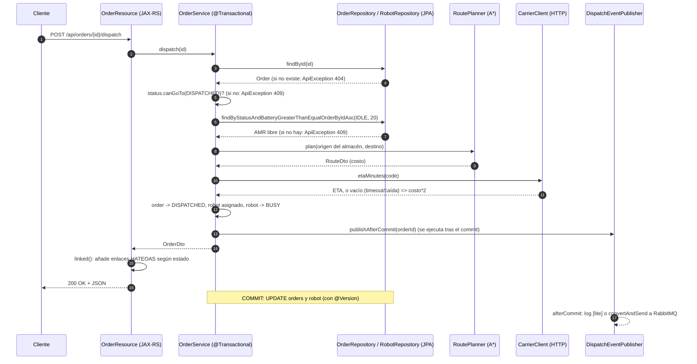

# INFORME — Laboratorio LOGISTPULSE

Modo de ejecución: **Modo A** (`./mvnw spring-boot:run`, H2 en memoria, puerto 8080, sin Redis/RabbitMQ). Java 21, Maven Wrapper.

## Parte 0 · Recorrido

### Qué se hizo
- Lectura de `OrderResource`, `OrderService`, `OrderStatus` y de `JerseyConfig`.
- Ejecución de `scripts/smoke.sh` con la aplicación levantada y de `./mvnw -q test`.

### Flujo de `POST /api/orders/{id}/dispatch`

### Cómo se probó
- `./mvnw -q test`: sin errores. Informes de surefire: `OrderStatusTest` 4 tests, `AStarPathfinderTest` 6 tests, 0 fallos.
- `bash scripts/smoke.sh` (app arriba): pasos 1–7 `ok` (200, 422, 201, 400, 200/409, 409). El paso 8 muestra el pedido 1 en `DISPATCHED`, robot `AMR-01`, `etaMinutes` 36 (el transportista en `localhost:9091` no está levantado, así que se usa el valor de respaldo `costo*2` = 18*2). El paso 9 devuelve 409, esperado en Modo A porque no hay consumidor RabbitMQ que pase el pedido a `IN_TRANSIT`. Terminó con "Smoke test terminado."

### ★ ¿Qué papel juega `JerseyConfig`? ¿Qué pasaría si olvidas registrar un recurso?
`JerseyConfig` extiende `ResourceConfig` y es el punto de configuración de Jersey: indica qué clases (`@Path` recursos y `@Provider` mappers) forman la aplicación JAX-RS. Spring Boot lo detecta por ser `@Component` y monta Jersey como servlet (`spring.jersey.application-path=/`). Que una clase sea `@Component` + `@Path` **no basta**: Jersey solo sirve lo que se registra explícitamente (no hay escaneo de paquetes aquí).

Verificación empírica: comenté `register(RobotResource.class)`, levanté la app y ejecuté `GET /api/robots`: respuesta **404 Not Found** (página HTML de Tomcat), sin ningún aviso o error en el log de arranque; mientras `GET /api/orders/1` seguía dando 200. Es decir, el fallo es silencioso y se manifiesta como 404. Lo mismo ocurre con un `ExceptionMapper` no registrado: la excepción no se traduce y se obtiene un 500 genérico. Se restauró el archivo después.
