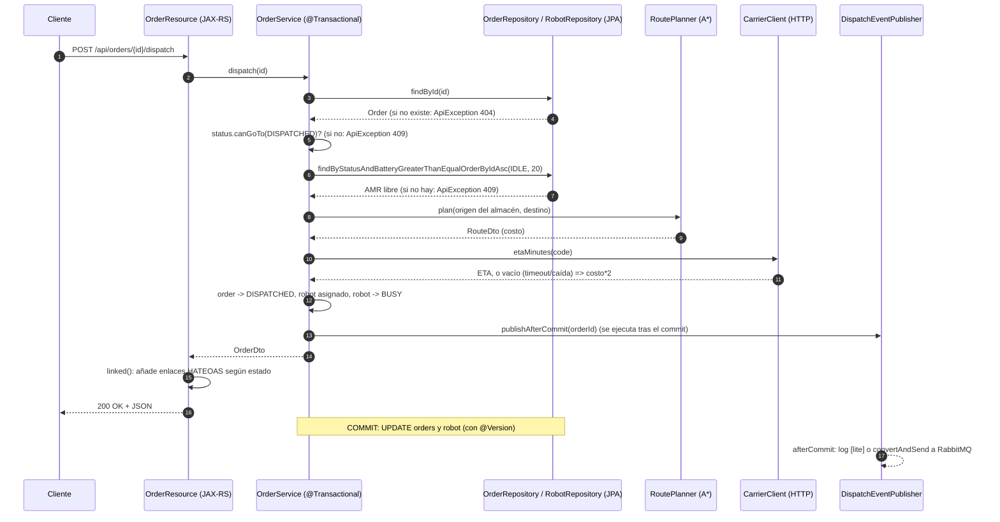

# INFORME — Laboratorio LOGISTPULSE

Modo de ejecución: **Modo A** (`./mvnw spring-boot:run`, H2 en memoria, puerto 8080, sin Redis/RabbitMQ). Java 21, Maven Wrapper.

## Parte 0 · Recorrido

### Qué se hizo
- Lectura de `OrderResource`, `OrderService`, `OrderStatus` y de `JerseyConfig`.
- Ejecución de `scripts/smoke.sh` con la aplicación levantada y de `./mvnw -q test`.

### Flujo de `POST /api/orders/{id}/dispatch`



### Cómo se probó
- `./mvnw -q test`: sin errores. Informes de surefire: `OrderStatusTest` 4 tests, `AStarPathfinderTest` 6 tests, 0 fallos.
- `bash scripts/smoke.sh` (app arriba): pasos 1–7 `ok` (200, 422, 201, 400, 200/409, 409). El paso 8 muestra el pedido 1 en `DISPATCHED`, robot `AMR-01`, `etaMinutes` 36 (el transportista en `localhost:9091` no está levantado, así que se usa el valor de respaldo `costo*2` = 18*2). El paso 9 devuelve 409, esperado en Modo A porque no hay consumidor RabbitMQ que pase el pedido a `IN_TRANSIT`. Terminó con "Smoke test terminado."

### ★ ¿Qué papel juega `JerseyConfig`? ¿Qué pasaría si olvidas registrar un recurso?
`JerseyConfig` extiende `ResourceConfig` y es el punto de configuración de Jersey: indica qué clases (`@Path` recursos y `@Provider` mappers) forman la aplicación JAX-RS. Spring Boot lo detecta por ser `@Component` y monta Jersey como servlet (`spring.jersey.application-path=/`). Que una clase sea `@Component` + `@Path` **no basta**: Jersey solo sirve lo que se registra explícitamente (no hay escaneo de paquetes aquí).

Verificación empírica: comenté `register(RobotResource.class)`, levanté la app y ejecuté `GET /api/robots`: respuesta **404 Not Found** (página HTML de Tomcat), sin ningún aviso o error en el log de arranque; mientras `GET /api/orders/1` seguía dando 200. Es decir, el fallo es silencioso y se manifiesta como 404. Lo mismo ocurre con un `ExceptionMapper` no registrado: la excepción no se traduce y se obtiene un 500 genérico. Se restauró el archivo después.

## Parte 1 · Jersey / JAX-RS

### Qué se implementó
- `GET /api/robots/{id}`: `RobotResource.get` (`@PathParam`) + `RobotService.get`; lanza `ApiException(404)` si no existe.
- `DELETE /api/orders/{id}`: `OrderResource.delete` devuelve 204; la regla de negocio está en `OrderService.delete` (solo `CREATED`; otro estado lanza `ApiException(409)`; inexistente 404).
- `api/ConstraintViolationMapper.java` (`ExceptionMapper<ConstraintViolationException>`), registrado en `JerseyConfig`. Devuelve 400 con `{"status":400,"error":"Validación fallida","violations":[{"field","message"}]}`. La ruta de la propiedad llega como `create.input.customer`, por lo que el mapper se queda con el último nodo (el nombre del campo).
- Test unitario `ConstraintViolationMapperTest` (sin contexto Spring).
- Ejemplos en `requests.http`.

### Cómo se probó
Antes de crear el mapper, un POST inválido (`{"code":"x","customer":"","destX":-1,"destY":0}`) ya daba 400, pero con **cuerpo HTML vacío de Tomcat** (`Content-Type: text/html`): Jersey tiene un mapper por defecto para `ValidationException` que fija el estado pero no entrega JSON. Con el mapper propio (más específico, registrado en `JerseyConfig`) la respuesta real fue:
```
HTTP/1.1 400
{"status":400,"violations":[{"message":"código con formato LP-XXXX","field":"code"},{"message":"no debe estar vacío","field":"customer"},{"message":"debe ser mayor que o igual a 0","field":"destX"}],"error":"Validación fallida"}
```
Resto de pruebas con curl (app en Modo A):
| Petición | Resultado |
|---|---|
| `GET /api/robots/2` | 200 `{"id":2,"code":"AMR-02",...}` |
| `GET /api/robots/99` | 404 `{"error":"Robot 99 no existe","status":404}` |
| `DELETE /api/orders/3` (CREATED) | 204; luego `GET /api/orders/3` = 404 |
| `DELETE /api/orders/1` (tras despacharlo) | 409 `Solo se pueden borrar pedidos CREATED; el pedido 1 está DISPATCHED` |
| `DELETE /api/orders/99` | 404 |

`./mvnw -q test`: 11 tests, 0 fallos (1 nuevo).

### ★ Equivalencias con Spring MVC
| JAX-RS / Jersey | Spring MVC |
|---|---|
| `@QueryParam("status")` (con `@DefaultValue`) | `@RequestParam(name = "status", defaultValue = "...")` (también `@PathVariable` para `@PathParam`) |
| `@Context UriInfo` (`getBaseUriBuilder()`, `getAbsolutePathBuilder()`) | `UriComponentsBuilder` como parámetro del método, `ServletUriComponentsBuilder.fromCurrentRequest()` / `fromCurrentContextPath()`, o `HttpServletRequest`; para enlaces a controladores, `MvcUriComponentsBuilder` |
| `ExceptionMapper<T>` + `@Provider` (registrado en `ResourceConfig`) | `@ExceptionHandler(T.class)` dentro de un controlador, o global con `@ControllerAdvice` / `@RestControllerAdvice` (y `ResponseEntityExceptionHandler`) |

Diferencia notable: en Jersey el mapper debe registrarse a mano; en Spring MVC `@ControllerAdvice` se descubre por escaneo de componentes.

## Parte 2 · JPA e Hibernate

### Qué se implementó
- Experimento N+1 (cambios temporales, restaurados): `spring.jpa.show-sql=true` y quitar `@EntityGraph` de `OrderRepository`.
- `domain/Order.java`: `@Table(name = "orders", indexes = @Index(name = "idx_orders_status", columnList = "status"))`.
- `spring.jpa.show-sql` queda en **`false`** al final (valor original): imprime por stdout, sin nivel de log ni formato, y en carga real inunda la salida y penaliza el rendimiento. Para diagnósticos puntuales es mejor `logging.level.org.hibernate.SQL=debug`.

### Cómo se probó
Para cada variante se arrancó la app limpia (H2 en memoria), se crearon 9 pedidos (12 en total con los 3 de la semilla), se despacharon los pedidos 3, 4, 5 y 6 (cuatro AMR distintos, todos dentro de la página) y se contaron las líneas `Hibernate:` generadas por una sola llamada a `GET /api/orders?size=10` (la página devuelve los ids 12 a 3).

| Variante | Consultas SQL | Detalle |
|---|---|---|
| Con `@EntityGraph(warehouse, robot)` | **2** | 1 `select` de pedidos con `join` a warehouse y robot + 1 `select count(...)` |
| Sin `@EntityGraph` | **7** | 1 `select` de pedidos + 1 `count` + 1 `select ... from warehouse where id=?` + 4 `select ... from robot where id=?` |

(Salida real: sin el grafo, las 4 consultas a `robot` aparecen una por cada AMR distinto de la página.)

### ★ ¿Cuántas consultas aparecen y por qué?
Sin `@EntityGraph` aparecen 7: la consulta principal (1) y el `count` de la paginación (1) más las consultas "+N" que dispara `OrderDto.from` al acceder a `getWarehouse().getName()` y `getRobot().getCode()`. Ambas asociaciones son `FetchType.LAZY`, así que la entidad trae solo un *proxy* con el id y Hibernate hace un `select` por cada proxy no inicializado al tocarlo. El warehouse costó 1 consulta (los 10 pedidos comparten el mismo, y el contexto de persistencia lo reutiliza tras la primera carga); los robots costaron 4 (uno por AMR distinto). Es el problema **N+1**: 1 consulta para la lista + N para las asociaciones; en el peor caso (N robots distintos) crece linealmente con el tamaño de página (aquí el máximo sería 1+1+1+10). El `@EntityGraph` indica a Spring Data que cargue `warehouse` y `robot` en la misma consulta con `left join`, dejando un coste constante de 2 consultas con independencia de N. (Usar `EAGER` en la entidad no lo resuelve: se cambiaría por N consultas igualmente y siempre, también donde no se necesitan.)

### Índice sobre `status`
Se verificó con `logging.level.org.hibernate.SQL=debug` que Hibernate emite `create index idx_orders_status on orders (status)`.
Justificación: `status` es el criterio de filtrado de `GET /api/orders?status=` (`findByStatus`) y de las operaciones sobre pedidos activos (p. ej. métricas por estado); sin índice cada filtro recorre toda la tabla `orders`, que es la que más crece (los `DELIVERED`/`CANCELLED` se acumulan). Salvedades: la cardinalidad es baja (5 valores), por lo que el índice solo es realmente útil cuando se filtra por estados poco frecuentes (`CREATED`, `DISPATCHED`, `IN_TRANSIT`), que son los operativos; además cada escritura (cambio de estado) también actualiza el índice. Con más tráfico sería preferible un índice compuesto `(status, id)` o `(status, created_at)` para cubrir también el orden de la paginación.
